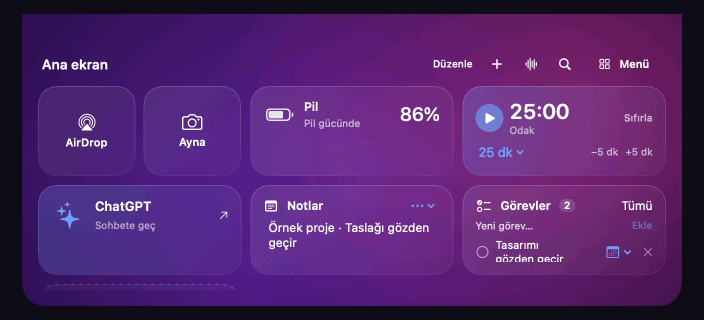

# Ada · Dynamic Island for Mac

[English](README.en.md) · [Kullanım kılavuzu](docs/USAGE.tr.md) · [Değişiklikler](CHANGELOG.md)

[**↓ Ada’yı Mac için indir (.dmg)**](https://github.com/frozenruzgar/ada-dynamic-island/releases/download/v0.12.1/Ada-0.12.1-AppleSilicon.dmg)

Apple Silicon (M serisi) ve macOS 14+. İndirilen DMG’yi aç, **Ada**’yı **Uygulamalar** klasörüne sürükle ve oradan aç.

0.12.1 noter onaysız bir önizlemedir. macOS ilk açılışta onay isteyebilir. [Apple’ın açma kılavuzu](https://support.apple.com/tr-tr/102445) · [Tüm sürümler](https://github.com/frozenruzgar/ada-dynamic-island/releases)

## Özellikler

MacBook çentiğinden açılan yerel çalışma alanı. Mor/pembe Nebula ve cam temaları, fareyle açılma ve klavye erişimi bulunur. Arayüz sistem diline göre Türkçe veya İngilizce açılır.

| Bölüm | Yapabileceklerin |
| --- | --- |
| Ana ekran | Kutucuk ekle, değiştir, sırala ve kaldır; tek Spotify kutucuğu |
| Oynatıcı | Gerçek kapak, süre, önceki/oynat/sonraki ve parça konumu |
| Dosyalar | Orijinalleri koruyan yerel kopyalar, dışarı sürükleme, saklama süresi |
| Odak ve metin | Sayaç, mola, teleprompter; okuma boyunca panel açık kalır |
| Asistan ve bulut | ChatGPT/Claude sayfaları, iCloud ve klasör kısayolları |
| Sistem | CPU, RAM, disk, düşük güç/ısıl durum ve uyanık tutma |

Fareyi çentiğe götür veya ⌃⌥A kullan. Müzik çalarken oynatıcı açılır; ev tuşu ana ekrana götürür. Menü → Ayarlar’dan görünümü ve davranışı değiştir. Otomatik başlatma Davranış bölümündedir. [Ayrıntılı kullanım](docs/USAGE.tr.md).

## Görünüm örnekleri

Ana ekran, oynatıcı ve dosya rafı, gerçek Ada arayüzünden örnek verilerle görüntülendi.



[Ana ekran](docs/images/dashboard.png) · [Oynatıcı](docs/images/player.png) · [Dosya rafı](docs/images/shelf.png)

## Derleme

Swift 5.9+, Python 3 ve macOS SDK içeren Apple Command Line Tools veya Xcode gerekir. Swift 6.2+ / macOS 26 SDK ile Liquid Glass derlenir; eski araç zincirlerinde uyumlu görünüm seçilir. Xcode 15/16 bu Mac’te henüz doğrulanmadı.

```sh
./scripts/build.sh
./scripts/check.sh
open dist/Ada.app
```

[Doğrulama kapsamı ve sınırlamalar](docs/VERIFICATION.md)

## Katkı, güvenlik ve gizlilik

[Katkı rehberi](CONTRIBUTING.md) · [Davranış kuralları](CODE_OF_CONDUCT.md) · [Güvenlik bildirimi](SECURITY.md) · [Gizlilik ve izin tablosu](PRIVACY.md)

Depo için ayrıca bir kaynak kod lisansı seçilmedi.

Ada bağımsız bir projedir; Apple, Spotify, OpenAI veya Anthropic ile bağlantılı değildir. Ticari markalar ilgili sahiplerine aittir.
